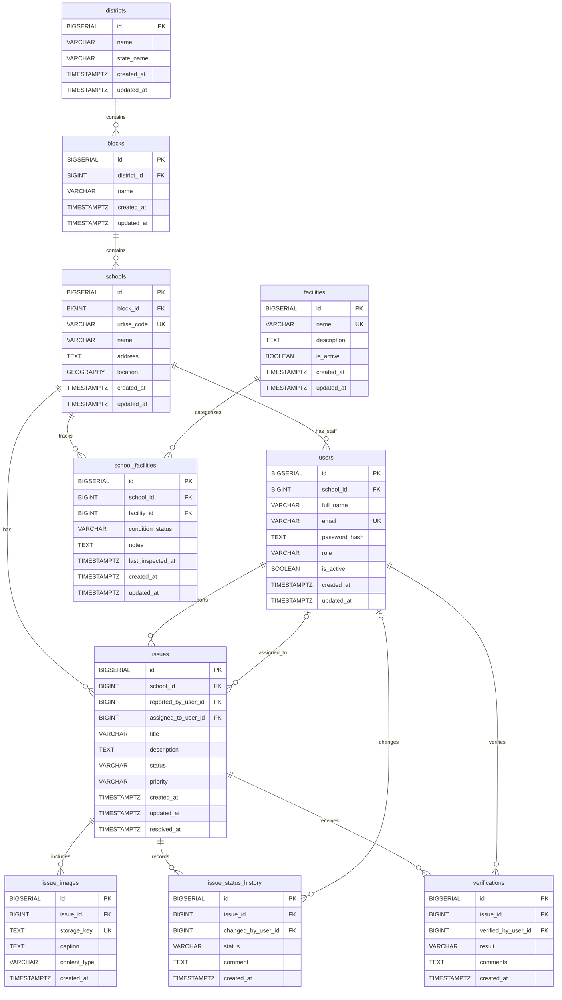

# School360 Entity-Relationship Diagram

`school_facilities` is the join entity between a school and a facility catalog entry. A
school's tracked facility condition is distinct from an `issues` report; an issue does
not need a facility record to exist.
